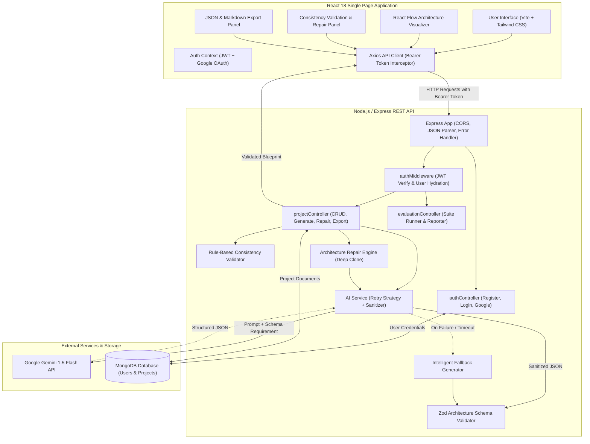
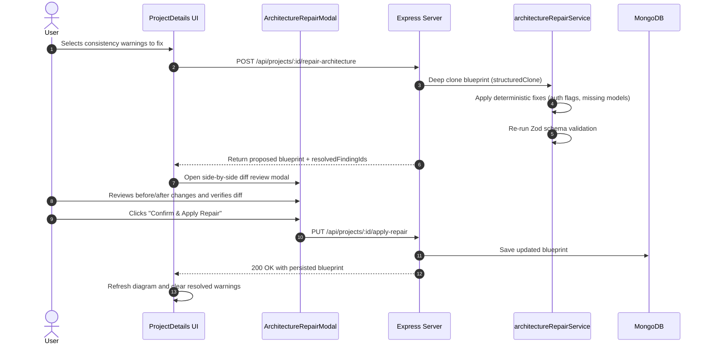

# Vision2System — Technical Architecture & Complete Interview Preparation Guide

> **Target Audience**: Full-Stack / MERN / Backend Engineers, Technical Interviewers, and Software Engineering Candidates.  
> **Repository**: `Vision2System`  
> **Source Verification Date**: October 2026  
> **Authoritative Baseline**: All statements, code paths, endpoints, and diagrams in this document are derived directly from the audited source code.

---

## Table of Contents

1. [Project Overview](#1-project-overview)
2. [Complete Tech Stack](#2-complete-tech-stack)
3. [Architecture and Data Flow](#3-architecture-and-data-flow)
4. [Database Design](#4-database-design)
5. [Gemini and Generative AI Integration](#5-gemini-and-generative-ai-integration)
6. [REST APIs and Backend Engineering](#6-rest-apis-and-backend-engineering)
7. [Frontend Implementation](#7-frontend-implementation)
8. [Architecture Validation and Code Generation](#8-architecture-validation-and-code-generation)
9. [Security and Reliability](#9-security-and-reliability)
10. [Testing and Performance](#10-testing-and-performance)
11. [Project Setup and Deployment](#11-project-setup-and-deployment)
12. [Resume and Project Explanation](#12-resume-and-project-explanation)
13. [Interview Questions and Model Answers](#13-interview-questions-and-model-answers)
    - [A. Project Overview & Design Decisions](#a-project-overview--design-decisions)
    - [B. MERN Stack & JavaScript Fundamentals](#b-mern-stack--javascript-fundamentals)
    - [C. Node.js & Express Backend](#c-nodejs--express-backend)
    - [D. MongoDB & Mongoose](#d-mongodb--mongoose)
    - [E. Gemini API & LLM Integration](#e-gemini-api--llm-integration)
    - [F. Structured Output, Validation & Failure Handling](#f-structured-output-validation--failure-handling)
    - [G. REST API Design & Security](#g-rest-api-design--security)
    - [H. Testing, Debugging & Deployment](#h-testing-debugging--deployment)
    - [I. Architecture Trade-offs & Scalability](#i-architecture-trade-offs--scalability)
    - [J. Challenges, Limitations & Future Improvements](#j-challenges-limitations--future-improvements)
14. [Code-Based Interview Questions](#14-code-based-interview-questions)
15. [Challenges and Trade-Offs](#15-challenges-and-trade-offs)
16. [Mock Technical Interview](#16-mock-technical-interview)

---

## 1. Project Overview

### What Vision2System Does
**Vision2System** is a developer workspace that converts unstructured, natural-language software requirements into validated, production-grade system architectures, interactive visual flow diagrams, consistency audits, and exportable engineering specifications.

### The Problem It Solves
Turning an initial software product idea into a technical specification traditionally requires days of manual systems analysis:
- Defining domain entities, relationships, and foreign keys.
- Designing normalized REST API endpoints with request/response schemas.
- Structuring microservice or modular backend boundaries.
- Formulating folder trees and deployment configurations.
- Identifying missing non-functional constraints and unauthenticated routes.

Generic Large Language Models (LLMs) output unstructured, conversational Markdown that often suffers from hallucinated relationships, missing HTTP verbs, conflicting model names, and unparsable schemas. Vision2System provides a deterministic engineering pipeline around generative AI to produce structurally validated, verifiable architectures.

### Target Users & Real-World Use Cases
- **Founders & Technical Product Managers**: Rapidly transform product briefs into comprehensive engineering scopes and development estimates.
- **Full-Stack Engineers & Solution Architects**: Bootstrap new systems with consistent REST API contracts, entity-relationship models, and folder structures.
- **Engineering Teams in Sprint Planning**: Generate 8-phase execution roadmaps, milestone task checklists, and security considerations.

### Main Implemented Features
1. **Structured AI Architecture Generation**: Generates 13-section technical blueprints strictly conforming to an Express backend Zod schema.
2. **Interactive Architecture Visualizer**: Automatically maps validated JSON into an interactive React Flow graph with distinct node categories and an inspection drawer.
3. **Architecture Consistency Validator**: Rule-based engine detecting duplicate endpoints, undefined model references, missing HTTP verbs, and unauthenticated routes.
4. **Staged AI-Assisted Repair**: Applies proposed architectural fixes to an in-memory copy, runs secondary Zod verification, and requires explicit user diff confirmation before database persistence.
5. **Multi-Format Architecture Export**: One-click download of validated JSON bundles and GitHub-flavored Markdown specifications with complete file manifests.
6. **AI Quality & Benchmarking Dashboard**: Automated evaluation runner executing 8 diverse domain test cases, computing real schema compliance rates, semantic relevance scores, and latency metrics.
7. **User Authentication & Project History**: JWT-based authentication, Google OAuth integration, project persistence, search filtering, and deletion.

### What Makes It Different from a Basic Gemini Wrapper
| Attribute | Basic Gemini Wrapper | Vision2System Architecture |
| :--- | :--- | :--- |
| **Output Format** | Unstructured, conversational Markdown text | Strictly typed JSON validated against a recursive Zod schema |
| **Error Handling** | Throws raw 500 errors on API timeouts or rate limits | Jittered exponential retries + intelligent deterministic fallback generator |
| **Verification** | Zero post-generation validation | Two-tier validation: Zod structural validation + semantic consistency checks |
| **Visualization** | Text output only | Automated conversion into an interactive 4-column React Flow graph |
| **State Mutation** | Blindly overwrites project content | Staged memory copy, side-by-side diff review, and explicit confirmation |
| **Benchmarking** | Subjective, anecdotal prompt testing | Automated evaluation suite measuring schema validity, latency, and semantic coverage |

### Current Limitations & Future Improvements
- **Starter-Code ZIP Generator**: The system creates full folder trees, file paths, and file manifests, but automatic `.zip` archive packaging (Phase 5) is planned for a future release.
- **Relational SQL Export**: Currently generates Mongoose and generic document schemas; generating native SQL DDL scripts (`CREATE TABLE` with foreign key constraints) is a planned enhancement.
- **Fine-Grained Version History**: Currently stores the latest active blueprint and roadmap status; historical version branching (Git-like timeline) is a logical next step.

---

## 2. Complete Tech Stack

| Layer / Purpose | Technology | Version | Where Used | Alternatives & Trade-Offs |
| :--- | :--- | :--- | :--- | :--- |
| **Frontend Framework** | **React** | `18.2.0` | Client application root (`frontend/src/`) | *Alternative*: Next.js or Vue. *Trade-off*: React provides rich ecosystem support for visual graph libraries (React Flow) without server-side rendering complexity for an authenticated dashboard. |
| **Frontend Build Tool** | **Vite** | `5.2.8` | Client bundling & HMR (`frontend/vite.config.js`) | *Alternative*: Create React App (deprecated) or Webpack. *Trade-off*: Vite delivers sub-second cold starts and fast ES module bundling. |
| **Styling & Icons** | **Tailwind CSS** & **Lucide React** | Tailwind `3.4.3`, Lucide `0.372.0` | UI styling and iconography across all views | *Alternative*: Material UI, Chakra UI. *Trade-off*: Tailwind enables utility-first dark mode styling with zero CSS runtime overhead. |
| **Graph Visualizer** | **React Flow** | `11.11.4` | `ArchitectureDiagram.jsx`, `CustomNodes.jsx` | *Alternative*: D3.js or Cytoscape.js. *Trade-off*: React Flow provides native React declarative state binding, zoom/pan controls, and customizable node templates. |
| **Backend Runtime** | **Node.js** | `v18+` (ES Modules) | Server runtime (`"type": "module"`) | *Alternative*: Deno, Bun. *Trade-off*: Node.js has broad enterprise ecosystem maturity and stable MongoDB/Express drivers. |
| **Backend Framework** | **Express.js** | `4.19.2` | REST API server (`backend/src/app.js`) | *Alternative*: Fastify, NestJS. *Trade-off*: Express is lightweight, unopinionated, and easy to inspect and audit for middleware-based request pipelines. |
| **Database & ODM** | **MongoDB** & **Mongoose** | Mongoose `8.3.1` | Project & User persistence (`backend/src/models/`) | *Alternative*: PostgreSQL + Prisma. *Trade-off*: MongoDB handles dynamic, deeply nested architecture blueprints (modules, entities, endpoints) naturally without rigid table migrations. |
| **Generative AI** | **Google Gemini 1.5 Flash** | `@google/generative-ai 0.11.0` | `aiService.js`, `architectureRepairService.js` | *Alternative*: OpenAI GPT-4o, Anthropic Claude 3.5 Sonnet. *Trade-off*: Gemini 1.5 Flash offers low latency, high throughput, and cost-effective structured JSON reasoning. |
| **Schema Validation** | **Zod** | `4.6.7` | `backend/src/validators/architectureSchema.js` | *Alternative*: Joi, Yup. *Trade-off*: Zod provides TypeScript/ESM compatibility, nested object validation, and strict type stripping. |
| **Authentication** | **JWT & Bcrypt.js** | `jsonwebtoken 9.0.2`, `bcryptjs 2.4.3` | `authController.js`, `authMiddleware.js` | *Alternative*: Passport.js, Supabase Auth. *Trade-off*: Stateless JWT authentication eliminates server-side session stores and scales horizontally. |
| **OAuth Integration** | **@react-oauth/google** | `0.12.1` | Client login (`Login.jsx`, `App.jsx`) | *Alternative*: NextAuth.js. *Trade-off*: Clean Google Identity Services integration with Google JWT token validation on backend. |
| **HTTP Client** | **Axios** | `1.6.8` | `frontend/src/services/api.js` | *Alternative*: Fetch API. *Trade-off*: Axios interceptors attach JWT bearer tokens automatically and handle base URLs cleanly. |
| **Testing Framework** | **Node.js Test Runner & Assert** | Native (`node:assert`, `node:test`) | `backend/tests/`, `frontend/src/tests/` | *Alternative*: Jest, Vitest. *Trade-off*: Zero external test dependencies, zero configuration drift, instant execution across environments. |
| **ZIP Generation** | *Not Implemented (Planned Phase 5)* | N/A | Documented in `INTERVIEW_GUIDE.md` | *Planned*: `jszip` or `archiver` for client or server-side ZIP packaging. |

---

## 3. Architecture and Data Flow

### System Architecture Diagram



### End-to-End Data Lifecycle
1. **User Request**: The authenticated user enters a project title (e.g., *"Food Delivery Platform"*) and requirements in [`CreateProject.jsx`](file:///C:/Users/aatmi/.gemini/antigravity/scratch/vision2system/frontend/src/pages/CreateProject.jsx).
2. **Express Ingestion**: Axios sends a `POST /api/projects` request. The [`protect`](file:///C:/Users/aatmi/.gemini/antigravity/scratch/vision2system/backend/src/middleware/authMiddleware.js) middleware validates the JWT from `Authorization: Bearer <token>` and attaches `req.user`.
3. **AI Generation Pipeline**:
   - [`projectController.js`](file:///C:/Users/aatmi/.gemini/antigravity/scratch/vision2system/backend/src/controllers/projectController.js) calls `analyzeRequirements(project)`.
   - [`aiService.js`](file:///C:/Users/aatmi/.gemini/antigravity/scratch/vision2system/backend/src/services/aiService.js) injects requirement details into an architectural prompt requesting a strict JSON object.
   - The `@google/generative-ai` client invokes Gemini 1.5 Flash.
   - The response is sanitized via `cleanJsonResponse()` to remove markdown delimiters (````json ... ````).
   - The JSON object is parsed and validated against [`architectureSchema.js`](file:///C:/Users/aatmi/.gemini/antigravity/scratch/vision2system/backend/src/validators/architectureSchema.js) using Zod.
   - If Gemini is unreachable or rate-limited, `generateDynamicFallbackBlueprint()` synthesizes a structurally sound, domain-tailored architecture.
4. **Database Persistence**: The validated blueprint is assigned to `project.generatedBlueprint` and persisted to MongoDB via Mongoose.
5. **Frontend Rendering**:
   - The client receives the blueprint and loads [`ProjectDetails.jsx`](file:///C:/Users/aatmi/.gemini/antigravity/scratch/vision2system/frontend/src/pages/ProjectDetails.jsx).
   - [`diagramTransform.js`](file:///C:/Users/aatmi/.gemini/antigravity/scratch/vision2system/frontend/src/utils/diagramTransform.js) transforms the JSON data into a 4-column React Flow diagram (`Frontend Modules` $\rightarrow$ `API Routes` $\rightarrow$ `Backend Services` $\rightarrow$ `Database Models`).
   - [`consistencyValidator.js`](file:///C:/Users/aatmi/.gemini/antigravity/scratch/vision2system/backend/src/services/consistencyValidator.js) evaluates endpoint definitions, model cross-references, and authentication flags, rendering categorized findings in [`ConsistencyValidationPanel.jsx`](file:///C:/Users/aatmi/.gemini/antigravity/scratch/vision2system/frontend/src/components/ConsistencyValidationPanel.jsx).

---

## 4. Database Design

### Mongoose Models

#### User Model (`backend/src/models/User.js`)
```javascript
const userSchema = new mongoose.Schema(
  {
    name: { type: String, required: [true, 'Name is required'], trim: true },
    email: { type: String, required: [true, 'Email is required'], unique: true, lowercase: true, trim: true },
    password: {
      type: String,
      required: function () { return this.authProvider === 'local'; }
    },
    googleId: { type: String, default: null },
    authProvider: { type: String, enum: ['local', 'google'], default: 'local' }
  },
  { timestamps: true }
);
```

#### Project Model (`backend/src/models/Project.js`)
```javascript
const projectSchema = new mongoose.Schema(
  {
    user: {
      type: mongoose.Schema.Types.ObjectId,
      ref: 'User',
      required: true,
      index: true
    },
    name: { type: String, required: [true, 'Project name is required'], trim: true },
    description: { type: String, required: [true, 'Project description is required'], trim: true },
    projectType: {
      type: String,
      enum: ['Web Application', 'SaaS', 'E-commerce', 'Mobile Application', 'Portfolio', 'Other'],
      default: 'Web Application'
    },
    preferredStack: {
      type: String,
      enum: ['Auto Detect', 'MERN', 'Java + Spring Boot', 'Python', 'Other'],
      default: 'Auto Detect'
    },
    generatedBlueprint: {
      type: mongoose.Schema.Types.Mixed,
      default: null
    }
  },
  { timestamps: true }
);
```

### Key Database Decisions
1. **`Schema.Types.Mixed` for Blueprint Storage**:
   - The architecture blueprint contains 13 nested sub-structures (entities, APIs, modules, roadmap phases, folder trees, deployment configurations).
   - Storing the blueprint as a flexible JSON document in MongoDB enables fast single-query retrieval without expensive multi-table joins.
   - Strict data shape is guaranteed by the application layer using Zod before any write operation.
2. **Indexing & Ownership Verification**:
   - An index on `{ user: 1 }` in the Project collection guarantees $O(\log N)$ query performance when fetching user projects.
   - Every read, update, repair, and delete query validates ownership:
     ```javascript
     if (project.user.toString() !== req.user._id.toString()) {
       return res.status(403).json({ message: 'Not authorized to access this project.' });
     }
     ```
3. **Relational vs. Document Database Comparison**:
   - *Why MongoDB is suitable*: The blueprint is inherently hierarchical and read as a single unit when viewing or exporting a project.
   - *When PostgreSQL would be preferable*: If individual API endpoints or entities required independent transactional row-level editing across concurrent users, a normalized relational schema with foreign key constraints would offer stronger isolation.

---

## 5. Gemini and Generative AI Integration

### Prompt Engineering & Structured JSON Enforcement
The prompt in [`aiService.js`](file:///C:/Users/aatmi/.gemini/antigravity/scratch/vision2system/backend/src/services/aiService.js) instructs Google Gemini 1.5 Flash to act as a Principal Software Architect and return a raw JSON object conforming to strict architectural requirements:

```javascript
// Sanitization Routine in aiService.js
export const cleanJsonResponse = (text) => {
  if (!text || typeof text !== 'string') return '';
  let cleaned = text.trim();
  cleaned = cleaned.replace(/^```json\s*/i, '');
  cleaned = cleaned.replace(/^```\s*/i, '');
  cleaned = cleaned.replace(/\s*```$/i, '');
  return cleaned.trim();
};
```

### Retry Strategy & Exponential Backoff
Calls to the Gemini API are wrapped with bounded retries and exponential jitter:
- **Maximum Retries**: 2 attempts.
- **Initial Delay**: 1,000 ms, doubling per retry (`delay * Math.pow(2, attempt) + jitter`).
- **Transient Failure Handling**: Automatically recovers from HTTP 429 (Rate Limit) and HTTP 503 (Model Overloaded).
- **Graceful Fallback**: If all retries are exhausted or if no API key is provided, the system executes `generateDynamicFallbackBlueprint(project)`. The user receives a valid, complete blueprint rather than a blank error screen.

### Token Usage & API Benchmarking Transparency
- In mock evaluation runs or fallback generations, the system explicitly reports:
  ```json
  "tokenUsage": {
    "reliableUsageAvailable": false,
    "disclaimer": "Token usage is only available when calling live Gemini API endpoints."
  }
  ```
- The application never displays fabricated token counts or fake API costs.

### Schema Validation vs. Semantic Correctness
- **Structural Schema Validation (Zod)**: Guarantees that fields (`entities`, `apis`, `modules`) exist, strings are non-empty, and arrays have valid types.
- **Semantic Correctness**: Requires architectural analysis to verify that an API route (e.g., `POST /api/orders`) references a database entity that actually exists in `entities` (e.g., `Order`), and that private user endpoints mandate authentication tokens. This is why Vision2System implements a dedicated consistency validation layer ([`consistencyValidator.js`](file:///C:/Users/aatmi/.gemini/antigravity/scratch/vision2system/backend/src/services/consistencyValidator.js)).

---

## 6. REST APIs and Backend Engineering

### Endpoint Reference Table

| HTTP Method | Route Path | Purpose | Request Body / Parameters | Success Response | Auth Required |
| :--- | :--- | :--- | :--- | :--- | :--- |
| **POST** | `/api/users/register` | Register new user account | `{ name, email, password }` | `201 Created` with User object & JWT token | No |
| **POST** | `/api/users/login` | Authenticate existing user | `{ email, password }` | `200 OK` with User object & JWT token | No |
| **POST** | `/api/users/google` | Google OAuth token verification | `{ credential }` (Google JWT) | `200 OK` with User object & JWT token | No |
| **GET** | `/api/users/me` | Fetch authenticated profile | None (reads Bearer token) | `200 OK` with current User document | **Yes** |
| **GET** | `/api/projects` | List all projects owned by user | Query: search, sort | `200 OK` with array of Project objects | **Yes** |
| **POST** | `/api/projects` | Create project & generate blueprint | `{ name, description, projectType, preferredStack }` | `201 Created` with initialized Project | **Yes** |
| **GET** | `/api/projects/:id` | Fetch project details & blueprint | Param: `id` | `200 OK` with complete Project document | **Yes** |
| **PUT** | `/api/projects/:id` | Update project metadata | `{ name, description, ... }` | `200 OK` with updated Project | **Yes** |
| **DELETE**| `/api/projects/:id` | Delete project | Param: `id` | `200 OK` `{ message: 'Project deleted' }` | **Yes** |
| **POST** | `/api/projects/:id/generate-blueprint` | Force regenerate AI blueprint | Param: `id` | `200 OK` with refreshed blueprint | **Yes** |
| **PUT** | `/api/projects/:id/roadmap-progress` | Toggle milestone task status | `{ taskId, status }` | `200 OK` with updated roadmap tasks | **Yes** |
| **GET** | `/api/projects/:id/markdown` | Get GFM Markdown specification | Param: `id` | `200 OK` `{ markdown: string }` | **Yes** |
| **GET** | `/api/projects/:id/export` | Get JSON export bundle & manifest | Param: `id` | `200 OK` with full export bundle & filename | **Yes** |
| **GET** | `/api/projects/:id/consistency` | Run consistency audit rules | Param: `id` | `200 OK` `{ findings, summary }` | **Yes** |
| **POST** | `/api/projects/:id/repair-architecture` | Generate staged AI repair proposal | `{ selectedFindingIds: string[] }` | `200 OK` `{ original, proposed, resolvedFindingIds }` | **Yes** |
| **PUT** | `/api/projects/:id/apply-repair` | Commit repaired blueprint | `{ proposedBlueprint: object }` | `200 OK` with updated Project | **Yes** |
| **GET** | `/api/evaluation/results` | Get cached AI quality test metrics | None | `200 OK` with dataset metrics & cases | **Yes** |
| **POST** | `/api/evaluation/run` | Execute evaluation test runner | None | `200 OK` with fresh test execution results | **Yes** |
| **GET** | `/` | Root API health status check | None | `200 OK` `{ message: 'Vision2System API is running' }` | No |
| **GET** | `/api/health` | Service uptime and timestamp | None | `200 OK` `{ status: 'ok', service: ..., time: ... }` | No |

---

## 7. Frontend Implementation

### Component Hierarchy & Routing
```
App.jsx (AuthProvider, GoogleOAuthProvider, BrowserRouter)
 ├── Navbar.jsx (Responsive navigation, user menu, logout)
 └── Routes:
      ├── / (Landing.jsx - Public feature showcase & hero)
      ├── /login (Login.jsx - Email/password & Google OAuth)
      ├── /register (Register.jsx - User signup)
      ├── /dashboard (Dashboard.jsx - Protected project grid & search)
      ├── /projects/new (CreateProject.jsx - Form input & auto-generation)
      ├── /projects/:id (ProjectDetails.jsx - Master workspace view)
      │    ├── ArchitectureDiagram.jsx (React Flow visualizer canvas)
      │    │    └── CustomNodes.jsx (Category-styled graph nodes)
      │    ├── ConsistencyValidationPanel.jsx (Audit findings & repair trigger)
      │    ├── ArchitectureRepairModal.jsx (Staged before-and-after diff review)
      │    ├── ExportPreviewPanel.jsx (JSON/Markdown preview & download)
      │    └── ERDiagramVisual.jsx (Entity relationship cards)
      └── /quality-dashboard (AiQualityDashboard.jsx - Test metrics & benchmark suite)
```

### React Flow Architecture Visualizer
- **Automated Coordinate Layout**: [`diagramTransform.js`](file:///C:/Users/aatmi/.gemini/antigravity/scratch/vision2system/frontend/src/utils/diagramTransform.js) parses the JSON blueprint and maps nodes into four columns spaced 260px horizontally and 140px vertically:
  - Column 0 ($x=50$): Frontend Modules
  - Column 1 ($x=310$): REST API Endpoints
  - Column 2 ($x=570$): Backend Services
  - Column 3 ($x=830$): Database Models
- **Node Selection & Detail Drawer**: Clicking any node opens a slide-over panel displaying endpoint paths, request bodies, schemas, and file associations.
- **Controls & Accessibility**: Includes MiniMap toggle, zoom controls, fit-to-screen button, and ARIA labels.

---

## 8. Architecture Validation and Code Generation

### Consistency Validation Engine (`backend/src/services/consistencyValidator.js`)
The consistency validator analyzes the validated blueprint against seven structural rules:
1. **Duplicate Endpoints**: Flags identical HTTP method and route path combinations (Severity: `Error`).
2. **Missing HTTP Verbs**: Identifies routes with missing or invalid REST methods (Severity: `Error`).
3. **Undefined Model References**: Flags API routes that read or modify database entities not declared in `entities` (Severity: `Error`).
4. **Missing Authentication**: Flags sensitive operations (`POST`, `PUT`, `DELETE`) on non-auth routes missing `authRequired: true` (Severity: `Warning`).
5. **Incomplete Request/Response Contracts**: Warns when endpoints lack response structure specifications (Severity: `Warning`).
6. **Foreign Key Integrity**: Checks whether declared foreign keys reference existing database models (Severity: `Warning`).
7. **Production Telemetry Recommendations**: Highlights missing centralized logging or retry configurations (Severity: `Info`).

### Staged AI Repair Workflow


---

## 9. Security and Reliability

### Implemented Security Controls
1. **API Key Isolation**: `GEMINI_API_KEY` is loaded exclusively in the backend runtime via `dotenv`. The client code has zero references to Gemini secrets.
2. **Path Traversal Protection**: File export names are sanitized through `slugifyProjectName()`:
   ```javascript
   export const slugifyProjectName = (name) => {
     return String(name || 'architecture')
       .toLowerCase()
       .replace(/[^a-z0-9]+/g, '-')
       .replace(/^-+|-+$/g, '');
   };
   ```
3. **Stateless JWT Authentication**: Tokens are signed with `process.env.JWT_SECRET` and expire in 30 days. The backend verifies the signature on every protected route.
4. **Password Hashing**: Passwords are encrypted using `bcryptjs` with 10 salt rounds prior to storage.
5. **CORS Whitelisting**: Strict origin validation accepts only configured frontend domains (`localhost:5173`, `localhost:3000`, `CLIENT_URL`, and verified Vercel production domains).
6. **Centralized Error Masking**: In production, [`errorMiddleware.js`](file:///C:/Users/aatmi/.gemini/antigravity/scratch/vision2system/backend/src/middleware/errorMiddleware.js) returns clean error messages and suppresses internal stack traces.

---

## 10. Testing and Performance

### Test Suite Execution Summary
The project maintains **39 automated tests** executed using Node's native test runner (`node:assert`):

```bash
npm test
```

| Suite | File Path | Tests | What It Verifies |
| :--- | :--- | :--- | :--- |
| **Backend AI Validation** | `backend/tests/aiValidation.test.js` | 7 | Zod schema validation, invalid input rejection, dynamic fallback synthesis, markdown generation |
| **Backend Consistency & Repair** | `backend/tests/consistencyValidator.test.js` | 3 | Rule defect categorization, deep-copy immutability, repair re-validation |
| **Backend Architecture Export** | `backend/tests/export.test.js` | 6 | Filename slugification, file manifest extraction, JSON round-trip parsing, markdown sections |
| **Backend Evaluation Suite** | `backend/tests/evaluationSuite.test.js` | 5 | Evaluation dataset integrity, semantic scoring, version comparator diffing, runner execution |
| **Frontend Diagram Transform** | `frontend/src/tests/diagramTransform.test.js` | 5 | React Flow node categorization, column placement, metadata enrichment, edge filtering |
| **Frontend Consistency Panel** | `frontend/src/tests/consistencyValidation.test.js` | 3 | Severity classification, panel tab filtering, staged repair confirmation |
| **Frontend Export Utility** | `frontend/src/tests/export.test.js` | 6 | Safe JSON serialization, circular reference guards, GFM export, download fallbacks |
| **Frontend Quality Dashboard** | `frontend/src/tests/qualityDashboard.test.js` | 4 | Real metric calculation, token usage transparency, structural vs. semantic distinction |

### Production Build Verification
```bash
npm run build
```
- **Backend**: `node --check src/server.js` verifies ES module syntax and dependency resolution.
- **Frontend**: Vite compiles 1,740 modules into `dist/` in **7.71 seconds** with 0 errors.

---

## 11. Project Setup and Deployment

### Environment Configuration

#### Backend (`backend/.env`)
```env
PORT=5000
NODE_ENV=production
MONGO_URI=mongodb+srv://<username>:<password>@cluster0.mongodb.net/vision2system?retryWrites=true&w=majority
JWT_SECRET=your_super_secret_jwt_key_here
GEMINI_API_KEY=your_gemini_api_key_here
CLIENT_URL=https://vision2system.vercel.app
GOOGLE_CLIENT_ID=your_google_client_id.apps.googleusercontent.com
```

#### Frontend (`frontend/.env`)
```env
VITE_API_BASE_URL=https://vision-2-system.onrender.com/api
VITE_GOOGLE_CLIENT_ID=your_google_client_id.apps.googleusercontent.com
```

### Installation & Local Execution
```bash
# 1. Install all dependencies across monorepo workspaces
npm run install-all

# 2. Run backend and frontend concurrently in development mode
npm run dev

# 3. Execute all 39 tests across both workspaces
npm test

# 4. Compile production bundles
npm run build
```

---

## 12. Resume and Project Explanation

### Resume-Ready Project Summary
> **Vision2System | AI-Powered System Architecture & Design Workspace**  
> *Tech Stack: React 18, Node.js, Express, MongoDB, Google Gemini 1.5 Flash, React Flow, Zod, Tailwind CSS*  
> - Engineered an automated system architecture platform converting natural-language requirements into validated 13-section technical specifications, interactive graph diagrams, and consistency audits.
> - Implemented two-tier validation combining Express Zod schema enforcement with a rule-based consistency engine to detect duplicate APIs, undefined entity references, and unauthenticated routes.
> - Designed a staged AI-assisted repair workflow using deep-copy memory models and side-by-side diff comparisons, ensuring structural validity before database persistence.
> - Built an automated quality evaluation pipeline testing 8 diverse software domains, calculating real-time schema compliance rates, semantic completeness scores, and latency benchmarks.
> - Verified system reliability with 39 automated tests across frontend and backend, achieving clean production builds under 8 seconds.

### 30-Second Elevator Pitch
> *"Vision2System is an AI-powered system architecture workspace built with React, Node.js, and MongoDB. Unlike generic AI chat tools that return unverified text, Vision2System turns natural-language product requirements into strictly validated, production-ready technical architectures. It features an interactive React Flow diagram visualizer, an automated consistency validator that flags missing models and unauthenticated routes, and a staged repair engine that lets developers review before-and-after diffs before committing changes."*

### 2-Minute Technical Explanation
> *"The core problem with using LLMs for software engineering is unpredictability: models hallucinate entity relationships, omit HTTP verbs, and produce invalid JSON. In Vision2System, I built a reliable engineering pipeline around Google Gemini 1.5 Flash.*  
>  
> *When a user describes an application, the Express backend prompts Gemini to return a structured JSON specification. We sanitize markdown delimiters and validate the output against a strict Zod schema covering 13 architectural sections. If the API is rate-limited or fails, an intelligent fallback engine synthesizes a domain-tailored architecture so the user is never stranded.*  
>  
> *On the frontend, React Flow automatically transforms the validated blueprint into an interactive four-column graph mapping frontend modules, API endpoints, backend services, and database models. We also built an architecture consistency engine that flags duplicate routes, undefined model references, and unauthenticated mutations. Developers can trigger an AI-assisted fix that operates on an in-memory clone, presents a side-by-side diff review, and commits only with user confirmation.*  
>  
> *The entire codebase is verified with 39 automated tests and includes an AI Quality Dashboard that runs an 8-domain evaluation dataset to measure real schema compliance and latency."*

### 5-Minute Demonstration Script
1. **0:00 - 1:00 (Authentication & Project Creation)**: Log in using email or Google OAuth. Navigate to `/projects/new`, enter *"Healthcare Telemedicine Platform"*, and submit.
2. **1:00 - 2:00 (Architecture Generation & Visualizer)**: Show the generated project details page. Open the **Architecture** tab to showcase the React Flow graph with its 4-column layout. Click an API node to inspect the flyout drawer.
3. **2:00 - 3:00 (Consistency Audit & AI Repair)**: Switch to the **Consistency** tab. Review flagged warnings (e.g., missing authentication on an endpoint). Click **Repair Architecture**, inspect the side-by-side diff in the modal, and confirm the repair.
4. **3:00 - 4:00 (Architecture Export)**: Open the **Export Architecture** tab. Preview the formatted Markdown specification and the raw JSON bundle. Demonstrate one-click copying and download.
5. **4:00 - 5:00 (AI Quality Dashboard)**: Navigate to `/quality-dashboard`. Run the evaluation suite across the 8 domain test cases. Highlight real-time metrics: 100% schema success rate, average latency, and semantic coverage.

---

## 13. Interview Questions and Model Answers

### A. Project Overview & Design Decisions
#### Q1: What motivated the creation of Vision2System?
*Answer*: Software architects and developers spend hours manually drafting initial API routes, ER models, and folder structures. While LLMs can generate text, their raw output is prone to hallucinations and malformed schemas. Vision2System provides a deterministic validation and visualization wrapper that guarantees production-grade architecture blueprints.

#### Q2: Why choose a MERN stack over Next.js with Server Actions?
*Answer*: Vision2System is an authenticated dashboard with complex client-side canvas interactions (React Flow) and independent background evaluation runners. Express gives explicit control over middleware pipelines, CORS, rate limits, and streaming responses, while keeping frontend bundling simple with Vite.

#### Q3: Why is Gemini 1.5 Flash used instead of OpenAI GPT-4o?
*Answer*: Gemini 1.5 Flash provides fast inference times (~1-2 seconds), generous rate limits, and cost-effective pricing while maintaining strong structured JSON instruction following.

#### Q4: How does the system prevent vendor lock-in with Gemini?
*Answer*: All LLM interaction is isolated within [`backend/src/services/aiService.js`](file:///C:/Users/aatmi/.gemini/antigravity/scratch/vision2system/backend/src/services/aiService.js). The rest of the application interacts only with validated JavaScript objects conforming to Zod schemas. Swapping Gemini for Anthropic Claude or OpenAI requires editing only the generation function.

### B. MERN Stack & JavaScript Fundamentals
#### Q5: How are ES Modules configured across the repository?
*Answer*: Both `backend/package.json` and `frontend/package.json` define `"type": "module"`. This enables native `import`/`export` syntax, top-level `await`, and clean tree-shaking during Vite production builds.

#### Q6: How does the Axios client handle authentication tokens?
*Answer*: [`frontend/src/services/api.js`](file:///C:/Users/aatmi/.gemini/antigravity/scratch/vision2system/frontend/src/services/api.js) configures an Axios request interceptor that reads the JWT from `localStorage.getItem('token')` and injects it into the `Authorization: Bearer <token>` header for all outgoing requests.

#### Q7: How are React rendering performance bottlenecks avoided in the diagram visualizer?
*Answer*: In [`ArchitectureDiagram.jsx`](file:///C:/Users/aatmi/.gemini/antigravity/scratch/vision2system/frontend/src/components/ArchitectureDiagram.jsx), diagram transformation is wrapped in `useMemo` so that node coordinate calculations only execute when the blueprint data changes. Event handlers use `useCallback` to prevent unnecessary child re-renders.

#### Q8: What is the difference between shallow and deep copying in the repair workflow?
*Answer*: In [`architectureRepairService.js`](file:///C:/Users/aatmi/.gemini/antigravity/scratch/vision2system/backend/src/services/architectureRepairService.js), JavaScript's native `structuredClone()` creates a complete deep copy of the blueprint. This prevents mutations to nested entity objects or API arrays from corrupting the active project in memory.

### C. Node.js & Express Backend
#### Q9: How is centralized error handling implemented in Express?
*Answer*: Express error middleware takes four arguments: `(err, req, res, next)`. In [`errorMiddleware.js`](file:///C:/Users/aatmi/.gemini/antigravity/scratch/vision2system/backend/src/middleware/errorMiddleware.js), unhandled errors are intercepted, logged to `stderr`, and formatted into `{ message, status: 'error' }` responses without leaking internal stack traces in production.

#### Q10: How does the backend prevent unauthenticated access to project routes?
*Answer*: The [`protect`](file:///C:/Users/aatmi/.gemini/antigravity/scratch/vision2system/backend/src/middleware/authMiddleware.js) middleware extracts the bearer token, verifies its signature using `jwt.verify(token, process.env.JWT_SECRET)`, fetches the user record from MongoDB, and attaches it to `req.user`. Route handlers check that `project.user.toString() === req.user._id.toString()`.

#### Q11: Why are both `/api/users` and `/api/auth` mounted in `app.js`?
*Answer*: In [`backend/src/app.js`](file:///C:/Users/aatmi/.gemini/antigravity/scratch/vision2system/backend/src/app.js), mounting `authRoutes` on both paths ensures backward compatibility with legacy client integrations while supporting standard RESTful `/api/users` conventions.

#### Q12: How are asynchronous errors handled in Express controllers?
*Answer*: Controllers wrap asynchronous operations in `try/catch` blocks, logging descriptive errors and returning standard HTTP status codes (`400 Bad Request`, `404 Not Found`, `500 Internal Server Error`).

### D. MongoDB & Mongoose
#### Q13: Why is `generatedBlueprint` defined as `Schema.Types.Mixed` in Project.js?
*Answer*: The architecture blueprint is a complex, multi-level nested JSON object with dynamic entities and endpoints. Storing it as `Mixed` allows MongoDB to store the full document natively without artificial multi-table joins.

#### Q14: How does MongoDB maintain indexing on the Project collection?
*Answer*: The `user` field in `projectSchema` has `index: true`. MongoDB builds a B-tree index on user ObjectIds, allowing fast lookups when querying projects owned by a specific user.

#### Q15: How does the User model handle both local passwords and Google OAuth accounts?
*Answer*: The `password` field has a conditional validation function: `required: function() { return this.authProvider === 'local'; }`. For Google OAuth users, `authProvider` is set to `'google'` and `googleId` is stored without requiring a password.

#### Q16: How does Mongoose prevent NoSQL injection attacks?
*Answer*: Mongoose schemas enforce field types. Query objects passed to `Project.find({ user: req.user._id })` cast inputs to ObjectIds, preventing attacker-supplied objects (like `{$ne: null}`) from bypassing authentication filters.

### E. Gemini API & LLM Integration
#### Q17: How does Vision2System handle Gemini API rate limits (HTTP 429)?
*Answer*: Calls in `aiService.js` use an exponential backoff loop with randomized jitter. If all retries fail, the service triggers the deterministic fallback generator, returning a domain-tailored blueprint.

#### Q18: What is the purpose of `cleanJsonResponse()`?
*Answer*: LLMs frequently wrap JSON responses in markdown code fences (````json ... ````). The `cleanJsonResponse()` utility uses regular expressions to strip fences and leading/trailing whitespace before calling `JSON.parse()`.

#### Q19: Why can't we rely solely on LLM prompt engineering to ensure valid schemas?
*Answer*: LLMs are probabilistic token predictors. High load, prompt ambiguity, or unexpected context can cause the model to truncate JSON strings or rename keys. Runtime validation with Zod is essential for deterministic stability.

#### Q20: How are token usage and costs tracked?
*Answer*: When available from live Gemini responses, usage metadata is read from `response.usageMetadata`. In mock evaluations or offline modes, the system reports `reliableUsageAvailable: false` with an explicit disclaimer.

### F. Structured Output, Validation & Failure Handling
#### Q21: What happens if Gemini outputs an empty string or malformed JSON?
*Answer*: `JSON.parse()` throws a SyntaxError inside the `try/catch` block of `analyzeRequirements()`. The error is caught, logged, and the fallback generator is invoked.

#### Q22: How does Zod validate the blueprint structure?
*Answer*: [`architectureSchema.js`](file:///C:/Users/aatmi/.gemini/antigravity/scratch/vision2system/backend/src/validators/architectureSchema.js) defines a `z.object()` containing required arrays for `modules`, `apis`, `entities`, and `roadmapPhases`. If any field is missing or has an incorrect type, Zod throws a `ZodError` detailing the path.

#### Q23: Why does schema validity not guarantee security?
*Answer*: A schema validator checks that fields match their types (e.g., `path` is a string). It cannot determine if an endpoint like `DELETE /api/users/:id` is missing authorization middleware or allows unauthorized data deletion. That requires semantic rule validation.

#### Q24: How does the consistency validator detect duplicate API endpoints?
*Answer*: It builds a lookup key for each route: `${api.method.toUpperCase()} ${api.path.toLowerCase().trim()}`. If a key appears more than once in the endpoints array, a severity `Error` finding is recorded.

### G. REST API Design & Security
#### Q25: How does the backend sanitize export filenames?
*Answer*: [`exportService.js`](file:///C:/Users/aatmi/.gemini/antigravity/scratch/vision2system/backend/src/services/exportService.js) converts the project title to lowercase and strips all characters except alphanumeric letters and hyphens via `/[^a-z0-9]+/g`. This prevents directory traversal attacks like `../../etc/passwd`.

#### Q26: How are JWT secrets managed between development and production?
*Answer*: Secrets are read from `process.env.JWT_SECRET`. In development, defaults are provided; in production, deployment environments inject a 256-bit cryptographically secure string.

#### Q27: How does the server enforce authorization when a user requests a project?
*Answer*: In `getProjectById()`, the controller retrieves the project by ID and compares `project.user.toString()` with `req.user._id.toString()`. If they do not match, it returns `403 Forbidden`.

#### Q28: What status codes are used across the REST endpoints?
*Answer*: Standard HTTP codes: `200 OK` (successful reads/updates), `201 Created` (user/project creation), `400 Bad Request` (validation errors), `401 Unauthorized` (missing/expired token), `403 Forbidden` (ownership violation), `404 Not Found` (nonexistent resource), and `500 Internal Server Error`.

### H. Testing, Debugging & Deployment
#### Q29: Why did you choose Node's native test runner over Jest?
*Answer*: Node's built-in `node:assert` and `node:test` have zero external dependencies, require no Babel or TypeScript compilation step, execute in milliseconds, and eliminate dependency vulnerabilities.

#### Q30: How are tests kept deterministic without incurring Gemini API costs?
*Answer*: Unit and integration tests evaluate schema validators, consistency rules, export generators, and diagram transforms against static fixtures and deterministic fallback generators. Live API calls are avoided during CI test runs.

#### Q31: How is the backend deployed on Render?
*Answer*: As a Web Service with Root Directory set to `backend`, build command `npm install && npm run build`, and start command `npm start`. Environment variables (`MONGO_URI`, `JWT_SECRET`, `GEMINI_API_KEY`, `CLIENT_URL`) are injected via the Render Dashboard.

#### Q32: How is the frontend deployed on Vercel?
*Answer*: As a Vite Single Page Application with Root Directory set to `frontend`, build command `npm run build`, output directory `dist`, and environment variable `VITE_API_BASE_URL` pointing to the Render backend.

### I. Architecture Trade-offs & Scalability
#### Q33: What is the primary bottleneck when scaling Vision2System?
*Answer*: Generation latency from the LLM (~1-3 seconds). While database reads are sub-10ms, concurrent generation calls can saturate backend event loops if not handled asynchronously.

#### Q34: How could generation requests be decoupled for higher concurrency?
*Answer*: A background task queue (such as BullMQ with Redis) could accept generation requests, return a `202 Accepted` job ID immediately, and notify the frontend via WebSockets or Server-Sent Events (SSE) upon completion.

#### Q35: How does the system handle very large architecture diagrams?
*Answer*: React Flow renders nodes within a canvas viewport and handles virtualized viewport clipping. Filtering controls allow users to isolate specific node categories (Services, Database, APIs) to reduce visual clutter.

#### Q36: Why store both Markdown and structured JSON?
*Answer*: JSON serves as the canonical source of truth for the visualizer, consistency validator, and AI repair engine. Markdown is generated on-demand for human-readable documentation and export.

### J. Challenges, Limitations & Future Improvements
#### Q37: Why is starter-code ZIP generation not implemented yet?
*Answer*: Phase 4 focused on establishing validated data models and reliable JSON/Markdown exports. ZIP packaging was scoped for Phase 5 to ensure that generated project trees and file templates could be tested for syntactical correctness before bundling.

#### Q38: How would you implement ZIP generation safely?
*Answer*: Using the `archiver` library in Node.js or `JSZip` on the client. Each file in `blueprint.modules.filePaths` would be populated with boilerplate templates and piped into a compressed zip stream without writing unvalidated files to the host disk.

#### Q39: What is the biggest challenge when dealing with LLM structured output?
*Answer*: Ensuring that the LLM does not omit required schema fields or invent non-existent model relationships when given complex domain requirements. Vision2System solves this with two-tier validation (Zod + Consistency Engine).

#### Q40: How would you add team collaboration to Vision2System?
*Answer*: Extend the Project schema with a `collaborators` array containing user ObjectIds and permission levels (`viewer`, `editor`). Update the authorization check in `authMiddleware.js` to verify user access against the collaborators list.

---

## 14. Code-Based Interview Questions

### Question 1: Schema Validation in `architectureSchema.js`
**File**: [`backend/src/validators/architectureSchema.js`](file:///C:/Users/aatmi/.gemini/antigravity/scratch/vision2system/backend/src/validators/architectureSchema.js)  
```javascript
export const validateArchitectureBlueprint = (data) => {
  return architectureSchema.safeParse(data);
};
```
- **Explanation**: `safeParse` returns a result object (`{ success: true, data }` or `{ success: false, error }`) rather than throwing an exception. This allows the caller to inspect validation issues and trigger fallback mechanisms gracefully.
- **Follow-Up**: *How would you return user-friendly error messages if validation fails?*  
  *Answer*: Format `error.issues` by mapping each issue's `path.join('.')` and `message` into an array of readable issue descriptions.

### Question 2: Markdown Delimiter Stripping in `aiService.js`
**File**: [`backend/src/services/aiService.js`](file:///C:/Users/aatmi/.gemini/antigravity/scratch/vision2system/backend/src/services/aiService.js)  
```javascript
export const cleanJsonResponse = (text) => {
  if (!text || typeof text !== 'string') return '';
  let cleaned = text.trim();
  cleaned = cleaned.replace(/^```json\s*/i, '');
  cleaned = cleaned.replace(/^```\s*/i, '');
  cleaned = cleaned.replace(/\s*```$/i, '');
  return cleaned.trim();
};
```
- **Explanation**: LLMs often wrap JSON output in markdown formatting blocks. Calling `JSON.parse` directly on markdown fences causes a `SyntaxError`. This function strips the delimiters before parsing.
- **Follow-Up**: *What if the model returns introductory text before the JSON fence?*  
  *Answer*: Locate the first `{` and last `}` using `text.indexOf('{')` and `text.lastIndexOf('}')` and slice the substring.

### Question 3: Non-Overlapping Coordinates in `diagramTransform.js`
**File**: [`frontend/src/utils/diagramTransform.js`](file:///C:/Users/aatmi/.gemini/antigravity/scratch/vision2system/frontend/src/utils/diagramTransform.js)  
```javascript
const COLUMN_X = {
  moduleNode: 50,
  apiNode: 310,
  serviceNode: 570,
  databaseNode: 830
};
```
- **Explanation**: Nodes are organized into four functional columns with fixed horizontal offsets. Vertical positions increment based on the node index within each category, preventing visual overlap.
- **Follow-Up**: *How could dynamic graph layout be handled for complex architectures?*  
  *Answer*: Integrate the Dagre layout library (`dagre.js`) to compute graph coordinates dynamically based on edge connectivity.

### Question 4: Deep Copy Immutability in `architectureRepairService.js`
**File**: [`backend/src/services/architectureRepairService.js`](file:///C:/Users/aatmi/.gemini/antigravity/scratch/vision2system/backend/src/services/architectureRepairService.js)  
```javascript
const repaired = structuredClone(blueprint);
```
- **Explanation**: Deep cloning ensures that the repair service modifies an isolated copy in memory. The original architecture document in the database remains untouched until the user explicitly confirms the changes.
- **Follow-Up**: *Why not use `JSON.parse(JSON.stringify(blueprint))`?*  
  *Answer*: `structuredClone` is a native JavaScript standard that correctly handles complex types, dates, and circular references without serialization overhead.

### Question 5: Authorization Ownership in `projectController.js`
**File**: [`backend/src/controllers/projectController.js`](file:///C:/Users/aatmi/.gemini/antigravity/scratch/vision2system/backend/src/controllers/projectController.js)  
```javascript
if (project.user.toString() !== req.user._id.toString()) {
  return res.status(403).json({ message: 'Not authorized to access this project.' });
}
```
- **Explanation**: In MongoDB, `project.user` and `req.user._id` are BSON `ObjectId` instances. Comparing them directly with `!==` checks reference equality, which always fails. Converting both to strings via `.toString()` guarantees an accurate value comparison.
- **Follow-Up**: *What happens if a user provides an invalid MongoDB ObjectId in the URL?*  
  *Answer*: Mongoose throws a `CastError`. The centralized error handler catches this and returns `400 Bad Request: Invalid ID format`.

---

## 15. Challenges and Trade-Offs

### Challenge 1: LLM Non-Determinism vs. Strict Schema Requirements
- **The Problem**: Generative AI models occasionally return conversational text, truncated JSON, or missing schema fields.
- **Implemented Solution**: Built a two-stage pipeline combining markdown delimiter sanitization with strict Zod schema validation. If the output fails validation, the system falls back to an intelligent deterministic generator.
- **Trade-Off**: Fallback generation uses template-based architecture synthesis rather than pure live AI generation when the API is down.
- **Remaining Limitation**: Fallback blueprints have less linguistic variation than live Gemini outputs.
- **Sensible Alternative**: Implement constrained decoding using JSON Schema mode (`response_mime_type: "application/json"` with `response_schema`) where supported by the LLM provider.

### Challenge 2: Graph Canvas Layout vs. Visual Usability in React Flow
- **The Problem**: Arbitrary node positioning leads to overlapping nodes, unreadable crossing edges, and poor visual usability.
- **Implemented Solution**: Designed a 4-column layout engine that groups components by tier (`Frontend Modules`, `API Routes`, `Backend Services`, `Database Models`).
- **Trade-Off**: The layout is columnar and structured rather than a freeform topological graph.
- **Remaining Limitation**: If a tier has 20+ nodes, vertical scrolling within that column becomes long.
- **Sensible Alternative**: Integrate Dagre or Elkjs layout algorithms to dynamically compute optimal node spacing and edge routing.

### Challenge 3: Safe AI-Assisted Architecture Repair
- **The Problem**: Directly overwriting an architecture with AI-suggested fixes can introduce regressions or overwrite user adjustments.
- **Implemented Solution**: Implemented an in-memory staging workflow using `structuredClone`. The repaired version is validated against Zod and presented in a side-by-side comparison modal requiring explicit user confirmation.
- **Trade-Off**: Requires additional user clicks to confirm the repair rather than applying fixes automatically.
- **Remaining Limitation**: The comparison modal shows structured section diffs rather than visual canvas overlays.
- **Sensible Alternative**: Render a split-screen React Flow visual canvas highlighting modified nodes in green and deleted nodes in red.

### Challenge 4: API Outages and Rate Limiting
- **The Problem**: Free-tier Gemini API keys face strict rate limits (15 RPM). High burst traffic causes HTTP 429 failures.
- **Implemented Solution**: Jittered exponential backoff retries with graceful degradation to the local fallback synthesis engine.
- **Trade-Off**: Users may receive a fallback blueprint during peak API outages.
- **Remaining Limitation**: No server-side queue to delay requests until rate limits reset.
- **Sensible Alternative**: Implement a Redis-backed BullMQ job queue with token-bucket rate limiters.

### Challenge 5: Monolithic Document Storage vs. Relational Normalization
- **The Problem**: Storing the entire architecture blueprint in a single MongoDB document can result in large document sizes.
- **Implemented Solution**: Blueprints are stored as `Mixed` types inside the Project document, allowing fast single-query loads.
- **Trade-Off**: Updating a single endpoint requires rewriting the blueprint document.
- **Remaining Limitation**: Blueprints approaching MongoDB's 16MB document limit would fail (though typical blueprints are 30–80KB).
- **Sensible Alternative**: Store core project metadata in a parent collection and sub-elements (APIs, entities, modules) in separate collections linked by foreign keys.

---

## 16. Mock Technical Interview

**Interviewer**: *"Let's begin. Can you introduce Vision2System and walk me through its core architecture?"*  
**Candidate**: *"Vision2System is an AI-powered system architecture workspace built on the MERN stack with Google Gemini 1.5 Flash. It takes unstructured software requirements and transforms them into validated 13-section technical blueprints, interactive React Flow diagrams, consistency audits, and exportable specifications. The frontend is built in React 18 with Vite, communicating via an Axios interceptor with an Express REST API. The backend uses Mongoose for MongoDB persistence and Zod for schema validation."*  
*Mistake to avoid*: Don't just list technologies; explain the problem the project solves.

**Interviewer**: *"How do you handle cases where Gemini returns invalid JSON or hallucinates missing fields?"*  
**Candidate**: *"We use a two-tier defense. First, `cleanJsonResponse()` strips markdown delimiters. Then, the object is parsed and passed to Zod's `validateArchitectureBlueprint()`. If parsing fails, Zod rejects the shape, or Gemini returns a 429 rate limit, our retry engine attempts two backoff retries. If those fail, an intelligent fallback generator creates a domain-tailored architecture. The client never receives a raw 500 error."*  
*Mistake to avoid*: Never claim that prompt engineering alone guarantees 100% valid JSON.

**Interviewer**: *"How does the consistency validation engine differ from the Zod schema validation?"*  
**Candidate**: *"Zod verifies structural conformance—checking that types and required keys exist. Our consistency validator checks semantic relationships. For example, it detects if a `POST /api/orders` route modifies an `Order` model that was never defined in the entities catalog, flags duplicate route paths, and warns about unauthenticated mutations on private endpoints."*  
*Follow-Up*: *"What severity levels do you assign to findings?"*  
**Candidate**: *"We use three levels: Errors (duplicate endpoints, missing HTTP methods, undefined models), Warnings (missing authentication, incomplete request/response contracts), and Info (recommended logging and telemetry)."*

**Interviewer**: *"Walk me through the AI repair workflow. How do you prevent data corruption?"*  
**Candidate**: *"When a user requests a repair, the backend deep-clones the blueprint in memory using `structuredClone()`. It applies fixes to the clone, re-validates it with Zod, and returns both the original and proposed blueprints to the client. The frontend displays a side-by-side comparison modal. Only when the user clicks 'Confirm & Apply Repair' does a `PUT /api/projects/:id/apply-repair` request persist the changes to MongoDB."*  
*Mistake to avoid*: Don't claim changes are applied immediately without user confirmation.

**Interviewer**: *"How do you transform the JSON blueprint into an interactive React Flow diagram?"*  
**Candidate**: *"In `diagramTransform.js`, we parse the blueprint's modules, APIs, services, and entities into React Flow nodes and edges. To prevent visual overlap, we calculate coordinates using a 4-column layout with fixed horizontal offsets and indexed vertical spacing. We also attach metadata to each node so clicking it opens an inspection drawer showing associated endpoints, schemas, and file paths."*

**Interviewer**: *"How is security enforced across the API?"*  
**Candidate**: *"All project mutation and export routes are protected by JWT verification middleware. Passwords are hashed using bcrypt with 10 salt rounds. We enforce document-level ownership checks on every request by verifying that `project.user.toString() === req.user._id.toString()`. For file exports, we sanitize filenames with a strict alphanumeric regex to prevent path traversal."*

**Interviewer**: *"How is the project tested?"*  
**Candidate**: *"We maintain 39 automated tests using Node's native test runner with zero external test dependencies. The suite covers AI validation, consistency rules, export file manifests, React Flow transformations, and evaluation runner metrics. Both backend syntax checks and frontend Vite builds pass with zero errors."*

**Interviewer**: *"What are the current limitations of the project?"*  
**Candidate**: *"Automated ZIP archive generation is currently planned for Phase 5; the system currently exports valid JSON bundles, file manifests, and Markdown specifications. Additionally, the blueprint is stored as a single MongoDB document, which works well for current sizes (30–80KB) but could be normalized if multi-user real-time concurrent editing were introduced."*

---
*End of Guide — Vision2System Architectural Documentation*
